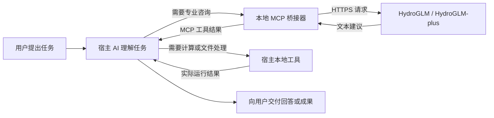

# MCP 原理与调用场景

本文介绍 MCP 的作用，以及 HydroGLM-MCP-Bridge 在实际任务中如何被调用。安装步骤见 [使用说明](使用说明.md)。

## MCP 是什么

MCP 是 Model Context Protocol 的缩写，中文通常称为“模型上下文协议”。它规定 AI 应用与外部服务如何交换工具描述、调用参数和结果。开发者可以按统一接口提供能力，客户端则通过协议发现并使用这些能力。MCP 本身不规定主控 AI 如何推理或如何安排任务。[MCP 官方架构说明](https://modelcontextprotocol.io/docs/learn/architecture)

理解本项目时，可以区分三个角色：

| 角色 | 负责什么 | 在本项目中的对应内容 |
| --- | --- | --- |
| 宿主应用及其 MCP 客户端 | 展示对话、向模型提供工具、按权限发起调用、接收结果 | Codex、WorkBuddy、Claude Desktop 等 |
| MCP 服务器 | 向客户端提供工具定义并执行收到的调用 | 本地运行的 `server.py` |
| 上游专业服务 | 接收专业问题并生成文本回答 | 瀚海 HydroGLM / HydroGLM-plus |

MCP 可提供工具（Tools）、资源（Resources）和提示模板（Prompts）等能力。本项目只提供 `ask_hydroglm` 工具，没有额外暴露文件资源或提示模板接口。[MCP 官方服务端能力说明](https://modelcontextprotocol.io/docs/learn/server-concepts)

## 它和 API、直接聊天、自定义指令有什么区别

| 方式 | 如何使用 HydroGLM | 适用需求 |
| --- | --- | --- |
| 直接在 HydroGLM 页面聊天 | 用户手动提问、查看回答 | 单独进行专业咨询 |
| Python 调用问答 API | 程序员编写请求、读取密钥并处理返回值 | 自己开发应用或批处理程序 |
| HydroGLM-MCP-Bridge | 宿主 AI 通过统一工具接口提出咨询，再接着完成当前任务 | 在现有 AI 工作流中组合专业咨询与其他工具 |
| 自定义指令或 Skill | 告诉宿主何时考虑某项能力、怎样组织工作 | 引导工具选择；调用仍需可用的工具实现 |

本项目把现有 API 包装成 MCP 工具。它不会更换宿主的主控模型，也不涉及对主控模型微调或安装新的模型权重。

## 在本项目中如何工作

客户端与桥接器之间使用 **stdio**：客户端启动 Python 子进程，通过标准输入、标准输出交换 JSON-RPC 消息；桥接器到瀚海的请求使用 HTTPS。这是两段不同的连接。[MCP 官方传输说明](https://modelcontextprotocol.io/specification/2025-06-18/basic/transports)

以“解释河道洪水演算方法，再编写 Python 示例”为例：

1. 客户端启动 `server.py`，完成初始化，发现 `ask_hydroglm` 及其参数。
2. 宿主 AI 判断是否需要专业咨询，整理需要询问的机理、条件或参数问题。
3. 客户端按自己的工具权限策略发起调用；需要用户确认的客户端可能先显示确认提示。
4. 桥接器读取所选模型的已保存密钥，向瀚海发送 `question` 和可选参数。
5. HydroGLM 返回文本，桥接器交回宿主；如果返回会话编号，宿主可在追问时传入。
6. 宿主结合建议，用自己的代码执行或其他工具生成并运行示例，检查结果，再向用户交付。

专业建议和实际运行结果是两个环节。仅调用 `ask_hydroglm` 并不能证明 Python 已运行或仿真已完成。

## 什么时候会调用

MCP 工具通常可由模型根据上下文选择；协议并不强制客户端采用固定的用户交互方式。实际使用中，宿主模型的选择、客户端配置、权限和用户指令都会影响调用。[MCP 官方工具交互说明](https://modelcontextprotocol.io/specification/2025-06-18/server/tools)

本项目在工具描述和初始化说明中提供水利任务选用建议。以下是建议的判断方式，而非逐个关键词匹配的固定触发器：

| 用户任务 | 是否适合咨询 HydroGLM | 后续工作 |
| --- | --- | --- |
| 解释产汇流、调洪或洪水传播的机理 | 适合，需要领域解释时考虑调用 | 宿主整理回答，核对关键公式 |
| 比较两种水文模型的适用条件 | 适合，需要专业方法比较时考虑调用 | 宿主结合实际资料评估选择 |
| 说明模型参数的意义与率定思路 | 适合，需要专业参数说明时考虑调用 | 用实际数据和本地程序率定、验证 |
| 分析调度方案的假设和规则是否合理 | 适合，需要专业判断时考虑调用 | 正式结论结合工程资料和实际计算复核 |
| 写一个水文计算程序并校验结果 | 可先咨询必要的领域问题 | 编程、运行和校验由宿主工具完成 |
| 读取已有 CSV，按指定字段画折线图 | 通常无需调用 | 宿主直接读取、绘图 |
| 修改通用 Python 报错或调整文档排版 | 通常无需调用 | 宿主使用编程或文档工具 |
| 查询某座水库此刻的实测水位 | 本项目没有提供实时监测数据库 | 需要另接获授权的数据源 |
| 用户明确说“不要使用外部服务” | 不调用 | 在允许的本地工具范围内工作 |

一次任务可以调用零次、一次或多次。即便任务与水有关，如果宿主已有足够信息，也未必需要额外咨询；需要追问时，宿主可再次发起调用。

### 日常直接提问

正常使用不需要写服务器名、工具名或调用参数，直接描述问题：

> 水库汛限水位有什么作用？

需要专业分析与本地计算时：

> 解释 Muskingum 河道汇流模型的适用条件，再用 Python 写一个示例并检查水量平衡。

希望指定 plus 时，也可使用自然语言：

> 这次使用 HydroGLM-plus，比较单库调度和梯级联合调度需要考虑的条件。

宿主 AI 根据任务和选用规则自动发起所需咨询，并在后台组织参数。用户不必逐次指挥工具调用。

### 按任务选择调用

服务的工具描述和初始化说明已包含自动选用提示。可进一步将 [按任务选用建议](按任务选用建议.md) 加入客户端支持的自定义指令，使领域任务的选用规则更明确；无需为每次提问追加“调用工具”。

如果没有按预期调用，检查工具列表、权限、指令和调用日志。这里的自动选用是宿主执行的任务判断，不是桥接器对每条消息做关键词匹配。

## 主要解决什么问题

### 在一个任务里衔接专业咨询与本地工作

例如用户需要分析水库调度数据，宿主可以先整理数据结构，咨询必要的领域概念，再继续编写和运行分析程序。专业咨询结果通过工具返回当前对话，减少在不同应用之间手动搬运问答的步骤。

### 让不同客户端复用同一个工具

本项目将模型选择、密钥读取、HTTP 请求和文本解析放在桥接器中。不同客户端使用相同的 `ask_hydroglm` 参数，只需分别配置如何启动本地服务。

### 保留宿主的工具组合能力

HydroGLM 提供专业文本建议；宿主保留文件访问、代码执行、表格和图表生成等能力。能完成哪些后续工作，取决于宿主实际提供的工具和权限。

这些是工作流层面的用途，不是答案精度、效率提升比例或工程适用性的量化承诺。本项目没有提供对应的效果评测数据。

## 如何确认真的调用了

本节用于首次验证和排障。日常直接提问即可，不必每次执行验证命令。

查看客户端工具记录，确认服务器为 `hydroglm_bridge`、工具为 `ask_hydroglm`，并查看实际参数和返回结果。成功返回文本，才说明本次专业咨询完成；错误结果需按提示排查。

需要单独检查工具连接和上游问答时，可在排障过程中明确指定一次：

> 请调用 hydroglm_bridge 的 ask_hydroglm，只回复“连接正常”。

这条命令用于诊断，不是正常使用前提。

| 看到的现象 | 能说明什么 |
| --- | --- |
| 客户端列出服务器和工具 | MCP 连接与工具发现成功，尚不能证明上游问答可用 |
| `ask_hydroglm` 返回有效回答 | 本次工具调用及上游问答完成 |
| 代码执行工具返回运行日志、数据或图表 | 宿主实际执行了对应本地工作 |

“连接成功”字样、普通聊天回答或生成出的代码本身，不能替代上述调用记录。

## 密钥、文件和联网分别怎样处理

密钥首次用 `configure_key.py` 保存，后续由桥接器自动读取。HydroGLM 和 HydroGLM-plus 使用各自绑定的密钥；两者可同时配置。

桥接器不主动读取业务文件或上传整个项目。但宿主可以把资料片段放入问题，此时片段会随 `question` 发往瀚海。使用内部资料前，应先确定允许传输的范围。凭据位置和权限见 [SECURITY.md](../SECURITY.md)。

`web_search` 和 `enable_thinking` 是传给上游的可选请求参数。它们不等于宿主的浏览器、代码执行权限，也不保证能取得某座水库的实时监测数据。未传参数时，桥接器沿用上游默认行为。

## 适用范围

本版提供本地 stdio 服务，适合能够启动 Python 子进程的客户端。瀚海的 `/chat/completions` 是上游问答接口，不能直接作为远程 MCP URL。仅支持远程 MCP 的平台需要额外网关；本项目没有包含该网关。

本版返回专业咨询文本，不自动操作水库、控制闸门、执行 HydroGLM 返回的代码或完成专业软件仿真。工程公式、数据和最终结论需在实际计算与资料中验证。

安装与排障见 [使用说明](使用说明.md)；客户端差异见 [版本与兼容](版本与兼容.md)。
